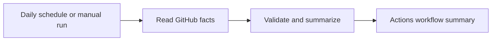
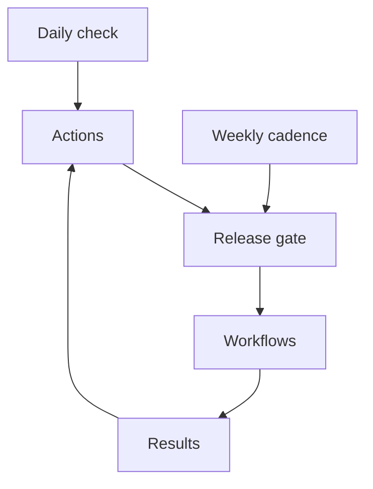

# Read-only release reconciliation

This helper summarizes release-related GitHub facts for human review. It does not
select a release version, gate or trigger a release, or persist train state.

## Current workflow

The GitHub Actions workflow runs daily at 14:00 UTC and can also be started
manually. It collects paginated GitHub API responses into a temporary directory,
validates them with `load_facts`, and publishes a bounded JSON report in the
workflow summary. It requires only read access to repository contents and
Actions.

The daily run is an observation schedule; publication cadence is evaluated
weekly. Neither schedule is a release trigger or gate. The report may flag
prerelease-only observations for policy review; owners still need to decide
whether prereleases qualify. No release version is selected.



The workflow does not notify Grot or Slack. Its summary is not durable train
state. The current implementation is read-only; the architecture below is a
proposal, not functionality delivered by this workflow.

### Log integration contract

The report step emits the JSON exactly once between two case-sensitive marker
lines: `BEGIN_RELEASE_RECONCILIATION_REPORT` and
`END_RELEASE_RECONCILIATION_REPORT`. An external log consumer can use these
stable delimiters to extract the enclosed JSON; the Actions run log may add its
normal step prefixes to displayed lines. The workflow summary remains intended
for human reading and does not carry these markers. This repository defines the
output contract only; external integrations and delivery are configured and
verified separately. The marker contract does not imply that a notification
was sent or that any release action occurred.

## Target architecture {#target-architecture}

The proposed target is an Actions-owned lifecycle that reuses existing public
release workflows behind their exact candidate gates. In sequence, it would:

1. Select the weekly Beyla candidate and resolve its source revisions.
2. Prepare the paired Beyla and OBI release branches.
3. Wait for branch CI and stop on failures or ambiguous results.
4. Create the prerelease/tag and artifacts through existing workflows.
5. Deploy the release to development.
6. Deploy to operations and validate it there.
7. Promote the release to stable/latest.
8. Deploy the stable release to production.
9. Follow up on Alloy; an Alloy PR may be prepared once the release is
   available, but should be merged only after stable.

Daily checks observe release and CI facts; the weekly publication cadence is
distinct from those checks. Completion events can wake reconciliation, but
GitHub remains authoritative. Grot conversation or investigation may be an
optional integration, not a core dependency. The core assumes no database or
always-on service. Candidate selection, health criteria, approvals, and
prerelease policy remain maintainer decisions, not guarantees enforced by
these workflows; this target does not promise unconditional publication. The
current workflow above remains read-only and does not implement this lifecycle.

The diagram summarizes target coordination components; the numbered list
describes the release sequence.



The diagram is a target summary for public review. The current workflow above
only observes and reports; it does not implement lifecycle progression.

## Local checks

Run the deterministic helper tests with:

```sh
python3 -m unittest discover -s scripts/release-reconciliation -p 'test_*.py'
```
