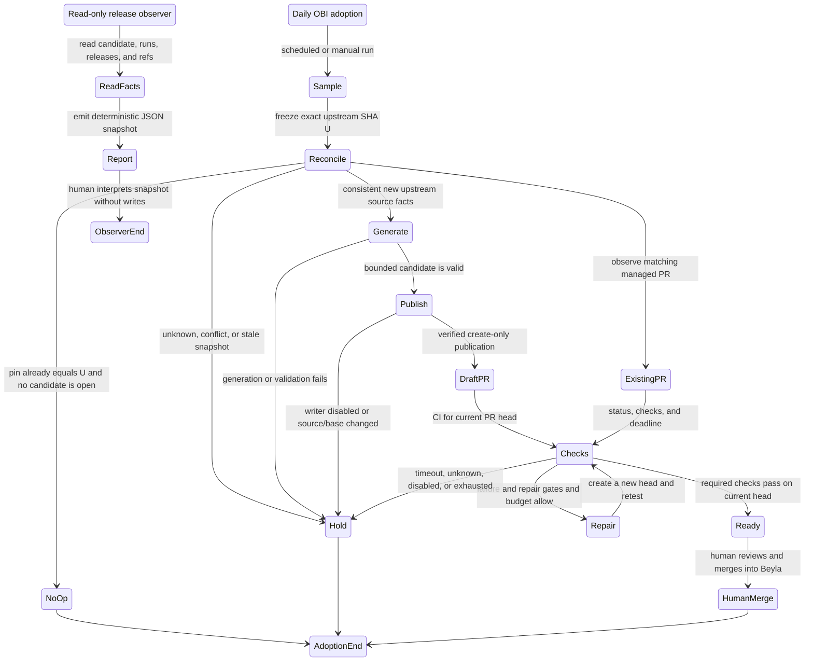

# OBI adoption and release reconciliation

This is the single operator guide for two related but independent workflows. **OBI adoption** proposes source and compatibility changes to Beyla. **Release reconciliation** is a read-only observer of release facts. Neither flow authorizes production rollout or deployment.

## Workflow map



The lanes do not hand off automatically: adoption ends at a human-merged Beyla PR; the observer independently reports what GitHub currently exposes. An adoption merge is not a release, deployment, or production operation. The observer does not select a version, approve a release, or publish one.

## OBI adoption

The daily scheduled/manual path in `.github/workflows/bot_sync-obi-submodule.yml` replaces that workflow's former weekly updater schedule; it is one coordinated writer, not a second daily writer. Before merge, owners must approve the schedule cutover and publication policy. Merging replaces the weekly cron even if the default-off publication flag remains unset.

Preflight samples one immutable upstream commit (`U`), compares Beyla's `.obi-src` pin (`P`) and current main (`B`), verifies ancestry against upstream OBI `main`, and inspects existing/rejected adoption PRs. The accepted 24-hour goal is a conservative commit-age proxy for the oldest pending upstream change, using committer timestamps; it is not true first-availability lag and does not block adoption by itself. It is freshness context, not publish or release authorization. Unknown source evidence fails closed. The selected SHA is not changed mid-run.

A consistent new candidate combines `.obi-src=U` with generated/vendor/compatibility changes. Generation has no repository-write credential; a trusted publisher rechecks current source/base/PR state, creates a managed branch only after GitHub verifies the candidate commit signature, then opens a draft PR. It never retargets or overwrites an existing candidate. Human review and merge remain required. With the writer flag off, a new candidate is not published; status-only reconciliation may still update the trusted status comment on an existing managed PR.

Existing managed PR status is maintained in one bot-owned comment. Required checks must apply to the current head; changes trigger retesting. Bounded compatibility repair is a separate path and requires **both** `OBI_ADOPTION_WRITER_ENABLED=true` and `OBI_ADOPTION_REPAIR_ENABLED=true`. A repair consumes the shared per-PR/target budget, uses the shared short writer lock and compare-and-swap checks, and cannot merge or mark a PR ready. Changing a variable does not instantly cancel an in-flight run.

The legacy `agent/fix-obi` label-driven fixer remains a separate workflow; moving its triage collector here does not change its trigger, authority, permissions, or behavior. The managed adoption repair path uses its own trusted supervisor and repair worker.

### Trust and enablement gates

Both publication flags default off. The repair workflow is callable only from the trusted supervisor on `main` for a completed failing `pull_request` CI run; it rereads the managed PR, source/base, status reservation, and triggering run before proposing and again before publishing. The model request uses a fixed Sonnet model without tools; the API key is confined to the trusted proposal job. Candidate Go code is tested separately without secrets, OIDC, or repository-write permission. The publisher accepts only a bounded, digest-checked manifest, rechecks file preconditions and PR identity, and requires GitHub's commit response to report `verification.verified` before a non-force branch update. It does not comment, change draft state, request reviewers, merge, or dispatch release work.

Before enabling either path, owners must verify the effective GitHub App permissions and signature response, repository publication policy, Actions event/log delivery, and required workflow/check identities. Repair additionally requires verification of Vault-backed token scope and model access. The pinned GitHub App token action accepts `github_app`, `permission_set`, and `vault_instance`; it does not support per-permission inputs, and this workflow does not claim that the `default` set is contents-only. If the token has excess scope, a narrower permission set requires a separately authorized infrastructure change. Trusted proposal/publisher code must not execute candidate code with write credentials. No live workflow was dispatched or activated for this implementation.

### Adoption implementation map

| Area | Location |
|---|---|
| Exact-SHA preflight, decision, manifest, and initial publisher | `adoption/preflight/` |
| Managed status, bounded repair policy, and trusted repair helper | `adoption/obi_adoption_supervisor.py`, `adoption/obi_adoption_repair.py` |
| Existing label-triggered fixer triage collector (separate legacy flow) | `adoption/legacy/collect_fix_obi_triage.py` |
| Read-only release observer | `observer/report.py` |
| Hermetic adoption and observer tests | `tests/` |
| Daily updater and CI controller | `.github/workflows/bot_sync-obi-submodule.yml`, `.github/workflows/obi-adoption-preflight.yml`, `.github/workflows/obi-adoption-repair.yml`, `.github/workflows/supervisor_rerun-flaky.yml` |

## Read-only release observer

Run the same collector used by CI:

```sh
mise run release:reconcile
```

Requirements: Mise, authenticated `gh` with read-only GitHub API access, `jq`, and Python 3. Set `REPOSITORY=owner/name` to select a repository, or run within a repository recognized by `gh`. The workflow uses only `contents:read` and `actions:read`.

The observer samples Beyla `main` and its pinned `.obi-src` SHA, preparation/tag workflow runs, GitHub releases, and Beyla `release-` refs. It emits deterministic JSON between `BEGIN_RELEASE_RECONCILIATION_REPORT` / `END_RELEASE_RECONCILIATION_REPORT` and appends the same report to the Actions summary. Missing or malformed facts are `unknown`, not success. The report is an observation snapshot, not a resume checkpoint or release decision. Weekly cadence and stable/prerelease policy remain owner decisions.

## Checks

From the repository root:

```sh
PYTHONDONTWRITEBYTECODE=1 python3 -m unittest discover -s scripts/release-reconciliation/tests -p 'test_*.py'
python3 -m py_compile scripts/release-reconciliation/adoption/*.py scripts/release-reconciliation/adoption/preflight/*.py scripts/release-reconciliation/observer/*.py
```

Run `actionlint` on changed workflows and the documented repository lint before publishing changes. The README diagram is Mermaid source; use a compatible renderer to preview it when one is available.
