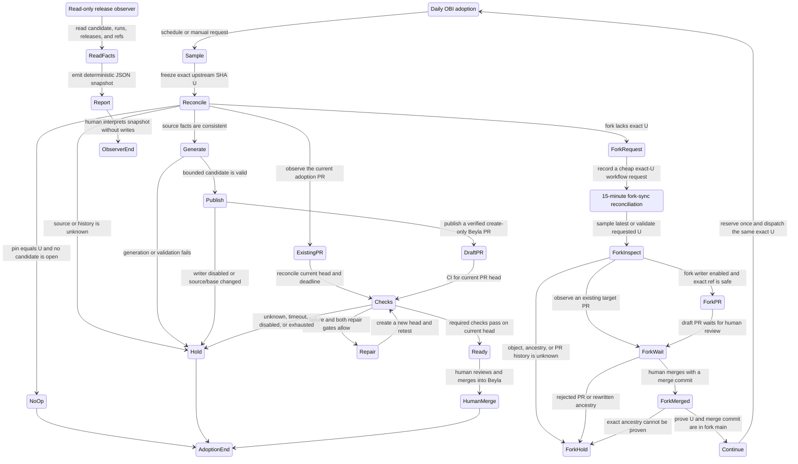

# OBI adoption and release reconciliation

This is the single operator guide for two related but independent workflows. **OBI adoption** proposes source and compatibility changes to Beyla. **Release reconciliation** is a read-only observer of release facts. Neither flow authorizes production rollout or deployment.

## Workflow map



The adoption, fork-sync, and release-observer lanes are independent except for the explicit exact-SHA continuation from a verified merged fork PR into the existing adoption workflow. Adoption still ends at a human-merged Beyla PR. The observer independently reports what GitHub currently exposes. Neither workflow selects a release, deploys, or performs a production operation.

## OBI adoption

The existing daily scheduled/manual path in `.github/workflows/bot_sync-obi-submodule.yml` is the single coordinated Beyla adoption writer; this change does not add another adoption schedule. The fork workflow keeps its existing 15-minute cadence, but its old direct update attempt is replaced by a draft-PR process. Enabling the fork writer requires verifying the GitHub App's effective fork-repository permissions and human merge-commit workflow; no such flags or permissions were changed here.

Preflight samples one immutable upstream commit (`U`), compares Beyla's `.obi-src` pin (`P`) and current main (`B`), verifies ancestry and exact-`U` reachability from the OBI fork, and inspects existing/rejected adoption PRs. The accepted 24-hour goal is a conservative commit-age proxy for the oldest pending upstream change, using committer timestamps; it is not true first-availability lag and does not block adoption by itself. It is freshness context, not publish or release authorization. Unknown source evidence fails closed. The selected SHA is not changed mid-run.

A consistent new candidate combines `.obi-src=U` with generated/vendor/compatibility changes. Generation has no repository-write credential; a trusted publisher rechecks current source/base/PR state, creates a managed branch only after GitHub verifies the candidate commit signature, then opens a draft PR. It never retargets or overwrites an existing candidate. Human review and merge remain required. With the adoption writer flag off, a new Beyla candidate is not published; status-only reconciliation may still update the trusted status comment on an existing managed PR.

### Fork-sync PR and exact-SHA continuation

The fork workflow no longer calls GitHub's update endpoint on protected `grafana/opentelemetry-ebpf-instrumentation:main`. A read-only preflight samples one exact OBI commit `U`, checks that `U` is visible as a commit in the fork, and inventories the managed branch/PR state. With `OBI_FORK_SYNC_WRITER_ENABLED=true`, the trusted publisher creates only `sync-obi-upstream-U` at that exact commit and opens a draft PR against fork `main`; it does not update or force-push `main` or an existing branch. The flag is a separate default-off gate from `OBI_ADOPTION_WRITER_ENABLED`. No repository variables were changed by this implementation.

Daily adoption requests for a fork-missing `U` are cheap same-repository workflow-dispatch requests. The workflow run name records exact `U` and the originating daily run ID. Duplicate runs for one origin and target coalesce; conflicting targets for one origin are held. Request history is bounded and an incomplete inventory is unknown, not permission to create a PR. Requests that include the optional `source_pr`/`source_sha` compatibility cleanup do not enter this continuation, so those inputs are never silently dropped.

The 15-minute reconciler preserves an active managed fork PR and never retargets it. A recurring PR may use a later exact head `V` only when its compare base is the exact target of a previous verified managed merge; the resulting draft preserves both histories. After a human merges, the reconciler requires a merge commit and verifies that requested `U`, the PR head, and the PR merge commit are ancestors of current fork main. A squash/rebase or unknown ancestry blocks continuation. A later PR for `V` can satisfy an older daily request `U` only when those ancestry checks prove that it contains `U`.

Before continuing, the trusted App updates one bounded, bot-owned status comment on the verified merged fork PR. Its per-target ledger collapses duplicate request origins and reserves each exact `U` once. The workflow then dispatches the existing Beyla adoption workflow with that same `U` using the repository `GITHUB_TOKEN`; it never creates a second adoption writer. The dispatched workflow is revalidated by its workflow ID, default-branch ref, run name, and returned run ID. A reserved or ambiguous continuation is never blindly retried; failed generation or missing evidence requires human recovery. The existing adoption preflight, one-active-PR rules, repair gates, and human Beyla merge remain authoritative.

Existing managed PR status is maintained in one bot-owned comment. Required checks must apply to the current head; changes trigger retesting. Bounded compatibility repair is a separate path and requires **both** `OBI_ADOPTION_WRITER_ENABLED=true` and `OBI_ADOPTION_REPAIR_ENABLED=true`. A repair consumes the shared per-PR/target budget, uses the shared short writer lock and compare-and-swap checks, and cannot merge or mark a PR ready. Changing a variable does not instantly cancel an in-flight run.

The legacy `agent/fix-obi` label-driven fixer remains a separate workflow; moving its triage collector here does not change its trigger, authority, permissions, or behavior. The managed adoption repair path uses its own trusted supervisor and repair worker.

### Trust and enablement gates

The three independent publication gates default off: `OBI_ADOPTION_WRITER_ENABLED` controls new Beyla adoption PRs, `OBI_FORK_SYNC_WRITER_ENABLED` controls exact-SHA fork draft PRs, and `OBI_ADOPTION_REPAIR_ENABLED` additionally gates AI repair. Existing managed status comments may still be reconciled while publication is off. The repair workflow is callable only from the trusted supervisor on `main` for a completed failing `pull_request` CI run; it rereads the managed PR, source/base, status reservation, and triggering run before proposing and again before publishing. The model request uses a fixed Sonnet model without tools; the API key is confined to the trusted proposal job. Candidate Go code is tested separately without secrets, OIDC, or repository-write permission. The publisher accepts only a bounded, digest-checked manifest, rechecks file preconditions and PR identity, and requires GitHub's commit response to report `verification.verified` before a non-force branch update. It does not comment, change draft state, request reviewers, merge, or dispatch release work.

Before enabling any writer, owners must verify the effective GitHub App permissions and signature response, repository publication policy, Actions event/log delivery, and required workflow/check identities. Fork publication additionally requires the fork App scope and a human merge commit; adoption publication remains a draft PR; neither path marks ready or merges. Repair additionally requires verification of Vault-backed token scope and model access. The pinned GitHub App token action accepts `github_app`, `permission_set`, and `vault_instance`; it does not support per-permission inputs, and this workflow does not claim that the `default` set is contents-only. If the token has excess scope, a narrower permission set requires a separately authorized infrastructure change. Trusted proposal/publisher code must not execute candidate code with write credentials. No live workflow was dispatched or activated for this implementation.

### Adoption implementation map

| Area | Location |
|---|---|
| Exact-SHA preflight, decision, manifest, and initial publisher | `adoption/preflight/` |
| Exact-source fork PR and post-merge continuation reconciliation | `adoption/obi_fork_sync.py`, `.github/workflows/bot_sync-obi-fork.yml` |
| Managed status, bounded repair policy, and trusted repair helper | `adoption/obi_adoption_supervisor.py`, `adoption/obi_adoption_repair.py` |
| Existing label-triggered fixer triage collector (separate legacy flow) | `adoption/legacy/collect_fix_obi_triage.py` |
| Read-only release observer | `observer/report.py` |
| Hermetic adoption and observer tests | `tests/` |
| Daily updater and CI controller | `.github/workflows/bot_sync-obi-submodule.yml`, `.github/workflows/obi-adoption-preflight.yml`, `.github/workflows/obi-adoption-repair.yml`, `.github/workflows/supervisor_rerun-flaky.yml` |

## Read-only release observer

Run the same collector used by CI:

```sh
mise run release:reconcile
```

Requirements: Mise, authenticated `gh` with read-only GitHub API access, `jq`, and Python 3. Set `REPOSITORY=owner/name` to select a repository, or run within a repository recognized by `gh`. The workflow uses only `contents:read` and `actions:read`.

The observer samples Beyla `main` and its pinned `.obi-src` SHA, preparation/tag workflow runs, GitHub releases, and paired `release-` refs. It emits deterministic JSON between `BEGIN_RELEASE_RECONCILIATION_REPORT` / `END_RELEASE_RECONCILIATION_REPORT` and appends the same report to the Actions summary. Missing or malformed facts are `unknown`, not success. The report is an observation snapshot, not a resume checkpoint or release decision. Weekly cadence and stable/prerelease policy remain owner decisions.

## Checks

From the repository root:

```sh
PYTHONDONTWRITEBYTECODE=1 python3 -m unittest discover -s scripts/release-reconciliation/tests -p 'test_*.py'
python3 -m py_compile scripts/release-reconciliation/adoption/*.py scripts/release-reconciliation/adoption/preflight/*.py scripts/release-reconciliation/observer/*.py
```

Run `actionlint` on changed workflows and the documented repository lint before publishing changes. The README diagram is Mermaid source; use a compatible renderer to preview it when one is available.
