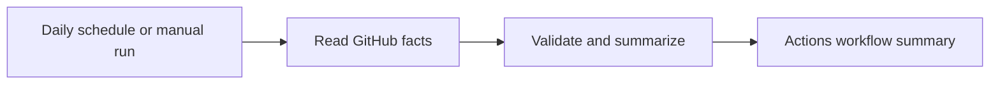

# Read-only release reconciliation

This helper summarizes release-related GitHub facts for human review. It does not
select a release version, gate or trigger a release, or persist train state.

## Current workflow

The GitHub Actions workflow runs daily at 14:00 UTC and can also be started
manually. It collects paginated GitHub API responses into a temporary directory,
validates them with `load_facts`, and publishes a bounded JSON report in the
workflow summary. It requires only read access to repository contents and
Actions.

The daily run is an observation schedule; publication cadence is evaluated
weekly. Neither schedule is a release trigger or gate. The report may flag
prerelease-only observations for policy review; owners still need to decide
whether prereleases qualify. No release version is selected.



The workflow does not notify Grot or Slack. Its summary is not durable train
state, and no wake-up/result bridge is configured or verified.

For the proposed end-to-end design, see the [Release automation architecture](https://github.com/grafana/beyla-internal/blob/gregor/docs-release-automation-architecture/docs/release-automation/README.md) and its [draft review](https://github.com/grafana/beyla-internal/pull/116).

## Local checks

Run the deterministic helper tests with:

```sh
python3 -m unittest discover -s scripts/release-reconciliation -p 'test_*.py'
```
