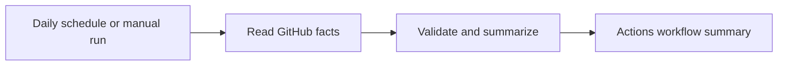
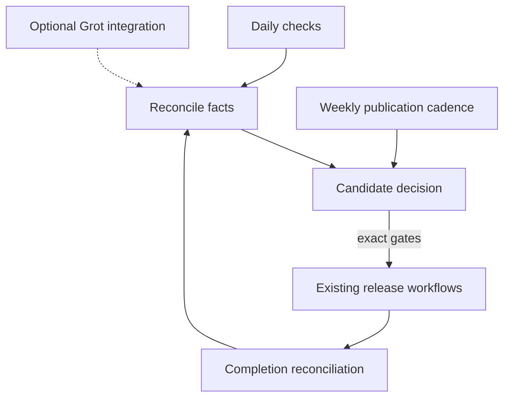

# Read-only release reconciliation

This helper summarizes release-related GitHub facts for human review. It does not
select a release version, gate or trigger a release, or persist train state.

## Current workflow

The GitHub Actions workflow runs daily at 14:00 UTC and can also be started
manually. It collects paginated GitHub API responses into a temporary directory,
validates them with `load_facts`, and publishes a bounded JSON report in the
workflow summary. It requires only read access to repository contents and
Actions.

The daily run is an observation schedule; publication cadence is evaluated
weekly. Neither schedule is a release trigger or gate. The report may flag
prerelease-only observations for policy review; owners still need to decide
whether prereleases qualify. No release version is selected.



The workflow does not notify Grot or Slack. Its summary is not durable train
state. The current implementation is read-only; the architecture below is a
proposal, not functionality delivered by this workflow.

## Target architecture {#target-architecture}

The proposed design keeps deterministic lifecycle ownership in public GitHub
workflows. Daily checks observe release and CI facts; a weekly publication
cadence remains distinct from those checks. A completion event can reconcile
the outcome, while existing public workflows continue to execute only under
their exact candidate gates. Grot conversation or investigation may be an
optional integration, but is not required for the core lifecycle. The core
assumes no database or always-on service. Candidate and prerelease policy
remain explicit decisions for maintainers; this proposal does not promise
unconditional or autonomous publication.



The diagram is a target summary for public review. The current workflow above
only observes and reports; it does not implement lifecycle progression.

## Local checks

Run the deterministic helper tests with:

```sh
python3 -m unittest discover -s scripts/release-reconciliation -p 'test_*.py'
```
